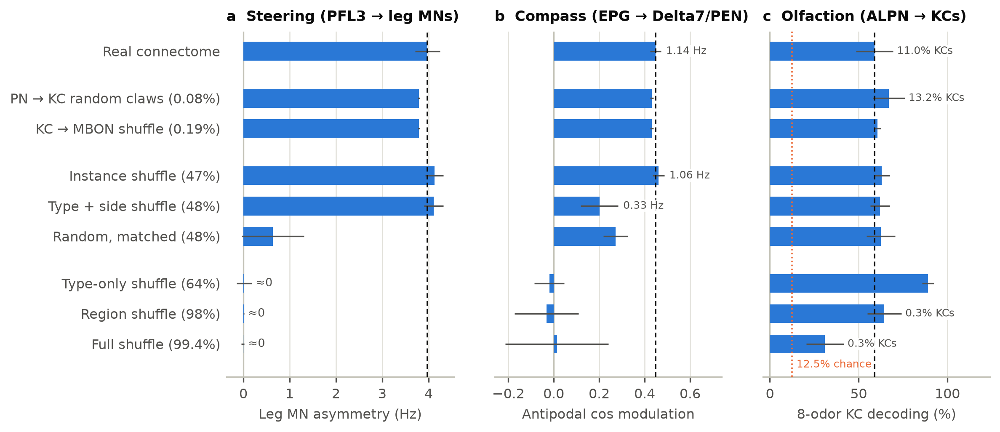
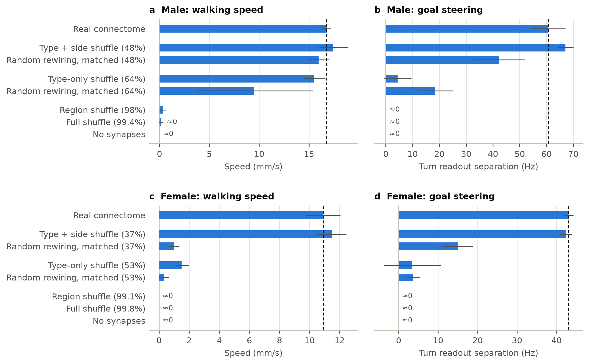
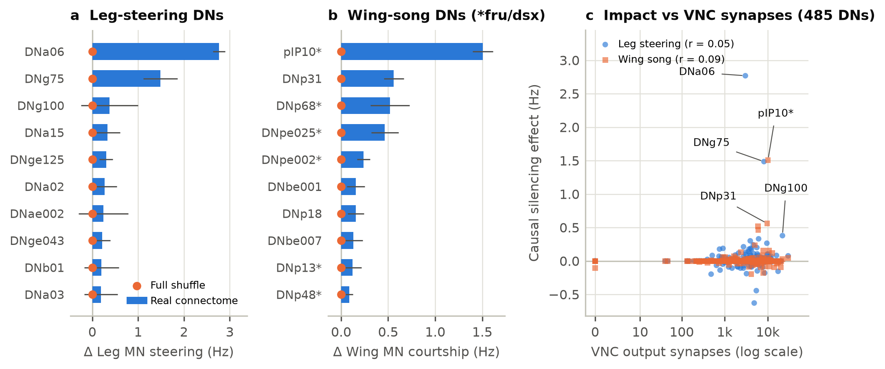
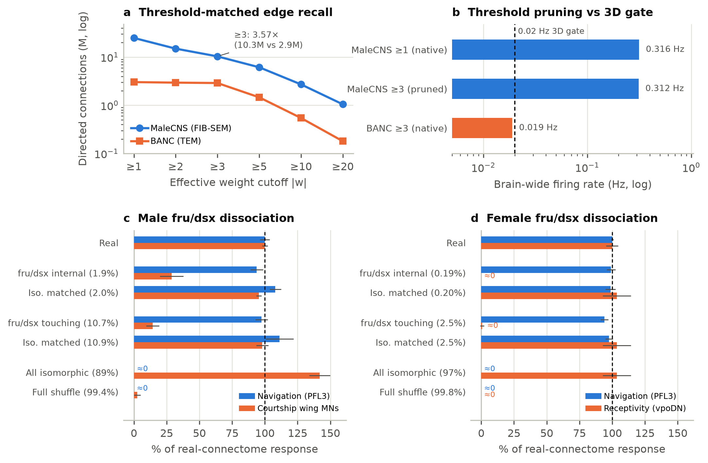

# Hierarchy of wiring specificity, parallel descending-neuron screens and dimorphic circuit organization in whole-CNS *Drosophila* connectome simulations

[](https://doi.org/10.5281/zenodo.23881805)
[](https://colab.research.google.com/github/indian-aman/drosophila-whole-cns-specificity/blob/main/colab/drosophila_whole_cns_specificity_colab.ipynb)
[](paper/manuscript.pdf)
[](LICENSE)
[](https://www.python.org/)

**Amandeep Bains** · Independent Researcher, Vadodara, Gujarat, India · [ORCID: 0009-0009-0689-2920](https://orcid.org/0009-0009-0689-2920)

[Manuscript (PDF)](paper/manuscript.pdf) · [Markdown](paper/manuscript.md) · [LaTeX](paper/manuscript.tex) · [Figures](figures/) · [Results JSON](results/) · [Colab Notebook](colab/drosophila_whole_cns_specificity_colab.ipynb)

---

## Overview

GPU-accelerated leaky integrate-and-fire (LIF) simulation and structural counterfactual framework for the complete adult male *Drosophila* central nervous system (**MaleCNS v1.0**: 167,565 proofread neurons; 25,623,478 directed connections; 124.2M synapses) and the adult female brain-and-nerve-cord connectome (**BANC v888**: 157,789 neurons; 3,036,600 connections at ≥ 3 synapses; 23.6M synapses).

Combining nine nested Maslov–Sneppen null models (preserving every neuron's exact in-degree, out-degree, outgoing synapse weights, and Dale's-law neurotransmitter sign), closed-loop 3D **NeuroMechFly v2** (`MuJoCo 3.16`) biomechanics, and a single-pass `K = 486` Common-Random-Numbers (`CRN`) virtual Split-GAL4 silencing engine, this work maps the anatomical granularity required across canonical circuits, screens every named descending-neuron cell type against disjoint VNC motor pools, and isolates sexually dimorphic *fru*/*dsx* routing within each EM reconstruction.

### At a glance

| Assay | Scope | Core finding | Key metric |
| :--- | :--- | :--- | :--- |
| **1. Wiring specificity hierarchy** | MaleCNS v1.0, 9 Maslov–Sneppen nulls | Olfaction, steering, and compass circuits break at three distinct anatomical granularities | Olfaction survives `PN → KC` claw shuffle (67.0% vs 59.0% native); steering requires `type + side` (4.11 vs 0.02 Hz `type-only`); compass breaks across 0.67% `instance` → `type + side` gap (0.46 → 0.20 cosine mod) |
| **2. Closed-loop 3D locomotion** | NeuroMechFly v2 (`MuJoCo 3.16`), Male + Female | Hemisphere-specific cell-type connectivity suffices for 3D walking and goal steering in both sexes | `type + side` preserves walking speed (17.5 vs 16.8 mm/s M; 11.5 vs 10.9 mm/s F) and steering (67.1 Hz M; 42.4 Hz F); `type-only` abolishes steering (4.4 / 3.5 Hz) |
| **3. Virtual Split-GAL4 DN screen** | K = 486 CRN slots across all 485 DN types (17.2 s) | Non-overlapping VNC motor pools separate true motor bottlenecks from readout self-overlap | Leg steering: **DNa06** (−90%, Δ = 2.77 Hz), **DNg75** (−49%); wing drive: **pIP10** #1 overall (−47%, Δ = 1.51 Hz); uncorrelated with VNC synapse count (r = 0.05–0.09) |
| **4. EM recall & *fru*/*dsx* switch** | FIB-SEM vs GridTape TEM + within-CNS subgraphs | Nominal synapse cutoffs do not equalize EM modalities; within-CNS *fru*/*dsx* rewiring double-dissociates social vs navigation circuits | MaleCNS retains 3.57× more edges at \|w\| ≥ 3; *fru*/*dsx* shuffles abolish male song/gating (−86%) and female vpoDN receptivity (35.2 → 0.2 Hz) while sparing navigation |

---

## Key findings

### 1. Three canonical circuits occupy three distinct rungs of wiring specificity (`Figure 1`, `Table 1`)

Evaluated under identical noisy LIF dynamics (τ = 20 ms, τ_syn = 5 ms, 20 Hz Poisson background, 5 rewire seeds × 5 noisy trials), three canonical circuits separate cleanly across the null-model hierarchy in MaleCNS v1.0:

- **Coarsest rung — Mushroom-body olfaction (8 ALPN glomeruli → 4,064 KCs → 37 MBON types):** Degree-preserving randomization of all 22,586 ALPN → KC claws preserves sparse KC coding (13.2% vs 11.0% active KCs) and 8-odor decoding (67.0% vs 59.0% in KCs; 36.1% vs 35.1% in MBONs), collapsing only under `region` (98%) or `full` (99.4%) shuffles (0.3% active KCs).
- **Middle rung — Descending motor steering (PFL3 → DN → 815 VNC leg MNs):** Survives `instance` (4.13 ± 0.19 Hz) and `type + side` (4.11 ± 0.21 vs 3.98 ± 0.27 Hz native) shuffles, drops sixfold under fraction-matched 48% global random rewiring (0.64 ± 0.67 Hz, p = 0.0079), and vanishes under midline-mixing `type-only` shuffling (0.02 ± 0.16 Hz).
- **Finest rung — Central-complex compass (8 EPG wedges → 44 Delta7/PEN glomerular instances):** Breaks sharply between `instance` (47.34% rewired) and `type + side` (48.01% rewired — differing across only 0.67% of CNS edges), cutting Delta7/PEN firing 3.3× (1.06 → 0.33 Hz, p = 0.0079), halving circular antipodal cosine modulation (0.46 → 0.20, p = 0.0079), and reducing 8-wedge decoding from 88.1% to 70.9% (12.5% chance). Post-stimulus EPG persistence decays to 3.8% (2.5–2.7 Hz), marking where static ring topology hands off to slower biophysical conductances.



---

### 2. Hemisphere-specific cell-type connectivity supports closed-loop 3D walking and steering in both sexes (`Figure 2`, `Table 2`)

- **Closed-loop 3D NeuroMechFly v2 (`MuJoCo 3.16`, 0.48 s goal-directed episodes):** `type + side` connectivity (48% MaleCNS, 37% BANC rewired) preserves 3D walking speed (17.46 ± 1.48 vs 16.77 ± 0.42 mm/s male; 11.47 ± 0.97 vs 10.91 ± 1.13 mm/s female), goal progress (75.1% vs 68.0% male; 44.2% vs 42.0% female), and steering separation (67.1 ± 2.9 vs 60.7 ± 6.4 Hz male; 42.4 ± 1.5 vs 43.1 ± 1.2 Hz female).
- **Midline cancellation vs locomotor gating:** `type-only` shuffling abolishes steering in both sexes (4.4 ± 5.1 and 3.5 ± 7.2 Hz), whereas `region` and `full` shuffles drop brain-wide firing below the 0.02 Hz tripod-oscillator gate and halt walking (0.15–0.37 mm/s male; 0.01 mm/s female).



---

### 3. Parallel `K = 486` Common-Random-Numbers virtual Split-GAL4 screen across all 485 descending-neuron cell types (`Figure 3`, `Table 3`)

Sharing one CSR matrix across `K = 486` state vectors under Common Random Numbers (0.000000 Hz max spread across unperturbed GPU slots; 17.2 s for 5 CRN seeds on a single NVIDIA G4 GPU) acutely silences every named DN cell type (slots 1–485 vs wild-type slot 0, modeling `Kir2.1 + TNT`) against strictly disjoint VNC motor pools:

- **Leg-motor steering (815 VNC leg MNs, WT 3.06 Hz):** Separates `turn_hz` descending readout members (DNb01 18.8 Hz, DNb02 17.9 Hz, DNa02 8.2 Hz) from true VNC leg-motor bottlenecks led by bilateral cholinergic **DNa06** (Δ = 2.77 ± 0.13 Hz, 90% loss) and **DNg75** (Δ = 1.49 ± 0.37 Hz, 49% loss).
- **Courtship wing drive (495 VNC wing MNs, WT 3.21 Hz):** Blindly recovers male-specific *fru*+ **pIP10** ranked #1 across all 485 DN types (Δ = 1.51 ± 0.11 Hz, 47% loss), followed by DNp31 (0.56 ± 0.10 Hz), DNp68\* (0.52 ± 0.21 Hz), DNpe025\* (0.46 ± 0.14 Hz), and DNpe002\* (0.24 ± 0.07 Hz).
- **Synapse-count independence:** Silencing impact is uncorrelated with total VNC output synapse count (Pearson r = 0.048 leg, r = 0.088 wing; Spearman ρ = 0.015, p = 0.74 wing), persists under `type + side` shuffling (DNa06: 2.74 Hz; pIP10: 1.54 Hz), and vanishes (0.00 Hz) under `full` shuffling.



---

### 4. Threshold-matched EM recall audit and within-connectome *fru*/*dsx* double dissociation (`Figure 4`, `Tables 4–5`)

- **FIB-SEM vs GridTape TEM recall audit:** At a matched cutoff |w| ≥ 3, MaleCNS (8 nm isotropic FIB-SEM) retains **3.57× more directed connections** than BANC (serial-section GridTape TEM) (10,326,400 vs 2,892,647; widening to 4.98× at ≥ 10 and 5.81× at ≥ 20). Pruning MaleCNS to |w| ≥ 3 leaves brain-wide firing at 0.312 Hz (15.6× above the 0.02 Hz 3D gate; 64.1 Hz steering), whereas native BANC fires at 0.019 Hz.
- **MaleCNS *fru*/*dsx* double dissociation (5,933 neurons = 3.54%):** Rewiring internal *fru*/*dsx* edges (1.9%) breaks mAL-like unaroused sensory gating onto pIP10 (1.0 → 22.8 Hz, p = 0.011). Rewiring *fru*/*dsx*-touching edges (10.7%) collapses aroused pIP10 (176.2 → 23.2 Hz) and wing MNs (3.14 → 0.45 Hz, −86%, p = 0.0079) while sparing PFL3 navigation (58.3 ± 2.8 vs 59.8 ± 2.2 Hz); rewiring all purely isomorphic edges (89%) abolishes navigation (0.0 Hz) while sparing pIP10 (181.0 Hz) and wing MNs (4.46 Hz).
- **Female BANC *fru*/*dsx* double dissociation (2,718 neurons = 1.72%):** Rewiring *fru*/*dsx* internal (0.19%) or touching (2.5%) edges abolishes vpoDN receptivity (35.2 → 0.0 and 0.2 ± 0.6 Hz, p = 0.0097 vs 36.5 Hz matched isomorphic) while sparing navigation (48.7 and 46.2 vs 49.2 Hz); rewiring all purely isomorphic edges (97%) abolishes navigation (0.0 Hz) while sparing vpoDN (36.5 Hz).



---

## Simulator architecture & Python quickstart

- **Shared-CSR GPU engine (`src/connectome_engine.py`):** Holds one read-only CSR connectivity matrix (< 250 MB) across `K` independent state arrays (> 45× memory reduction vs unshared graphs at `K = 100`), integrated in 1 ms steps via a coalesced active-row CUDA Triton gather–scatter kernel with automatic PyTorch/CPU fallback.
- **Zero-variance Common Random Numbers (`common_random_numbers=True`):** Broadcasts identical millisecond-by-millisecond Poisson draws across all `K` slots (`0.000000 Hz` spread across unperturbed slots), isolating exact single-cell-type `Kir2.1 + TNT` silencing deltas in one pass.
- **Exact Maslov–Sneppen rewiring (`src/structural_specificity.py`):** Permutes CSR column indices strictly within equivalence classes while verifying exact out-degree, exact in-degree, outgoing weight multisets, neurotransmitter signs, and byte-for-byte CPU-to-GPU CSR synchronization.

```python
from src.connectome_engine import ConnectomeDataset, WholeCNSEngine
from src.structural_specificity import CSRSnapshot, extract_dn_screen_catalog, rewire_within_type_side

ds = ConnectomeDataset()  # MaleCNS v1.0 (167,565 neurons; 25,623,478 directed edges)
cat = extract_dn_screen_catalog(ds)
dn_map = dict(zip(cat.dn_types, cat.dn_indices_per_type))

# Parallel CRN acute silencing: slot 0 = intact WT, slot 1 = DNa06 silenced, slot 2 = pIP10 silenced
eng = WholeCNSEngine(
    ds, num_brains=3, enable_callosum=False, homogeneous_tau_ms=20.0, common_random_numbers=True, seed=700
)
eng.set_perturbation_masks([None, dn_map["DNa06"], dn_map["pIP10"]])
res = eng.step_population(
    80,
    shared_stimuli=[(ds.idx_walk_tonic, 80.0), (ds.idx_pfl3_turnR, 250.0)],
    bg_poisson_hz=20.0,
    bg_subset_indices=ds.plastic_neurons[::16],
)
leg_asym_hz = res["leg_R_hz"] - res["leg_L_hz"]
print("WT vs DNa06-silenced vs pIP10-silenced leg MN asymmetry (Hz):", leg_asym_hz.round(2))

# In-place degree-, weight-, and sign-preserving shuffle with snapshot restore
snap = CSRSnapshot.capture(ds)
report = rewire_within_type_side(ds, seed=11)
print("Rewired fraction (type + side):", report["fraction_edges_rewired"])
snap.restore(ds)
# -> WT vs DNa06-silenced vs pIP10-silenced leg MN asymmetry (Hz): [1.46 0.1  1.46]
# -> Rewired fraction (type + side): 0.480056
```

---

## Installation & reproduction

### 1. Dependencies

Requires Python 3.10+. Install core simulation, 3D physics, and manuscript build packages:

```bash
pip install numpy scipy pandas pyarrow torch matplotlib flygym==2.1.1 mujoco==3.1.6 playwright
playwright install chromium
```

> **Note:** On Linux or Google Colab GPUs, PyTorch automatically enables `triton` for the coalesced active-row CSR gather–scatter kernel. You can also run end-to-end directly in the [turnkey Google Colab notebook](https://colab.research.google.com/github/indian-aman/drosophila-whole-cns-specificity/blob/main/colab/drosophila_whole_cns_specificity_colab.ipynb).

### 2. Connectome data setup

Place compiled MaleCNS v1.0 artifacts (`connectome_compiled.npz` and `neurons_meta.parquet`) in `data/compiled/` (or set `MALECNS_COMPILED_DIR`), and build or point `FEMALE_COMPILED_DIR` to Female BANC v888 (`data/female_compiled/`):

```bash
# Automatically downloads BANC v888 tables and compiles data/female_compiled/
python scripts/compile_female_banc.py
```

### 3. Run experiments, build manuscript & verify invariants

```bash
# 1. Three-circuit specificity hierarchy, K=486 DN screen & fru/dsx suite (~14 min on an NVIDIA G4 GPU)
#    Use --part hierarchy | screen | sex_switch | all
python experiments/run_structural_specificity_and_screen.py --part all

# 2. Closed-loop 3D NeuroMechFly v2 null-model ladder across MaleCNS v1.0 and Female BANC v888
CUDA_VISIBLE_DEVICES= OMP_NUM_THREADS=1 python experiments/run_3d_null_ladder.py --workers 16

# 3. Regenerate Figures 1-4, Tables 1-5, LaTeX, HTML and 11-page PDF manuscript
python scripts/build_paper.py

# 4. Run the 8-part numerical, biomechanical, and empirical invariant test suite
python -m unittest discover -s tests -v
```

---

## Repository structure

```text
paper/        manuscript.md (source of truth), manuscript.tex, manuscript.html, manuscript.pdf, references.bib
figures/      fig1..fig4 publication figures (300 DPI PNG)
results/      rewiring_3d_results.json, structural_specificity_screen_results.json
src/          connectome_engine.py          shared-CSR LIF simulator, CUDA Triton kernel & CRN perturbation masks
              structural_specificity.py     Maslov-Sneppen shuffles, cosine decoders, K=486 DN screen & fru/dsx probes
              vnc_neuromechfly_3d.py        closed-loop 3D NeuroMechFly v2 (MuJoCo 3.16) biomechanical coupling
              kc_mbon_matrix.py             15-compartment mushroom-body KC x MBON synaptic matrix
experiments/  run_structural_specificity_and_screen.py   specificity hierarchy, K=486 DN screen & fru/dsx suite
              run_3d_null_ladder.py                      closed-loop 3D NeuroMechFly v2 null-model ladder
scripts/      build_paper.py, build_colab_notebook.py, compile_female_banc.py
colab/        drosophila_whole_cns_specificity_colab.ipynb   turnkey G4 / H100 GPU Google Colab notebook
tests/        test_whole_cns_specificity.py                  automated numerical & empirical invariant tests
```

---

## Citation & upstream sources

Released under the [MIT License](LICENSE). Citation metadata are provided in [`CITATION.cff`](CITATION.cff) and [`.zenodo.json`](.zenodo.json):

```bibtex
@misc{bains2026hierarchy,
  title     = {Hierarchy of wiring specificity, parallel descending-neuron screens and dimorphic circuit organization in whole-CNS Drosophila connectome simulations},
  author    = {Bains, Amandeep},
  year      = {2026},
  publisher = {Zenodo},
  doi       = {10.5281/zenodo.23881805},
  url       = {https://doi.org/10.5281/zenodo.23881805},
  note      = {Independent Researcher, Vadodara, Gujarat, India. ORCID: 0009-0009-0689-2920}
}
```

### Upstream connectome & physics datasets
- **MaleCNS v1.0:** Berg et al., *Cell* 189, 5504–5526.e15 (2026), [doi:10.1016/j.cell.2026.08.015](https://doi.org/10.1016/j.cell.2026.08.015)
- **Female BANC:** Bates et al., *bioRxiv* (2025), [doi:10.1101/2025.07.31.667571](https://doi.org/10.1101/2025.07.31.667571)
- **LIF connectome parameters:** Shiu et al., *Nature* 634, 210–219 (2024), [doi:10.1038/s41586-024-07763-9](https://doi.org/10.1038/s41586-024-07763-9)
- **3D biomechanics:** NeuroMechFly v2, Wang-Chen et al., *Nature Methods* 21, 2353–2362 (2024), [doi:10.1038/s41592-024-02497-y](https://doi.org/10.1038/s41592-024-02497-y)
